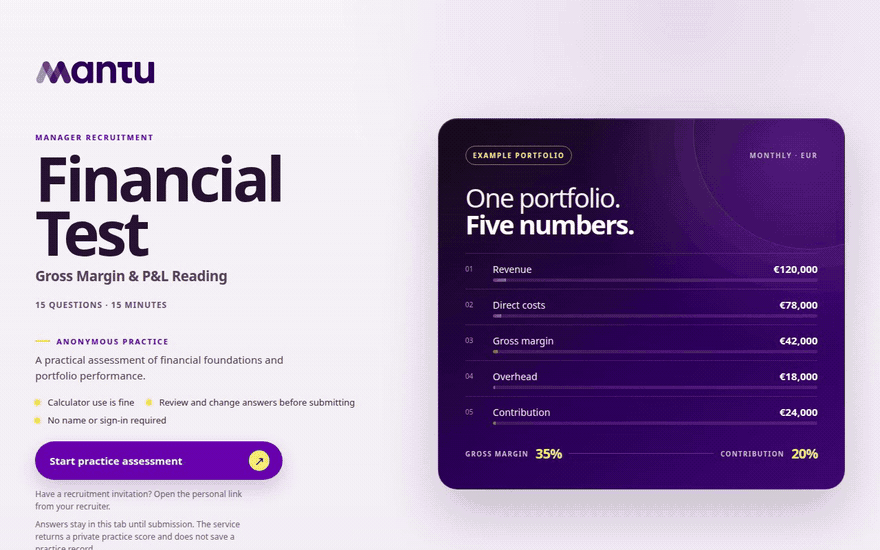
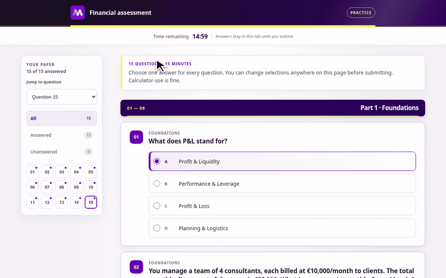
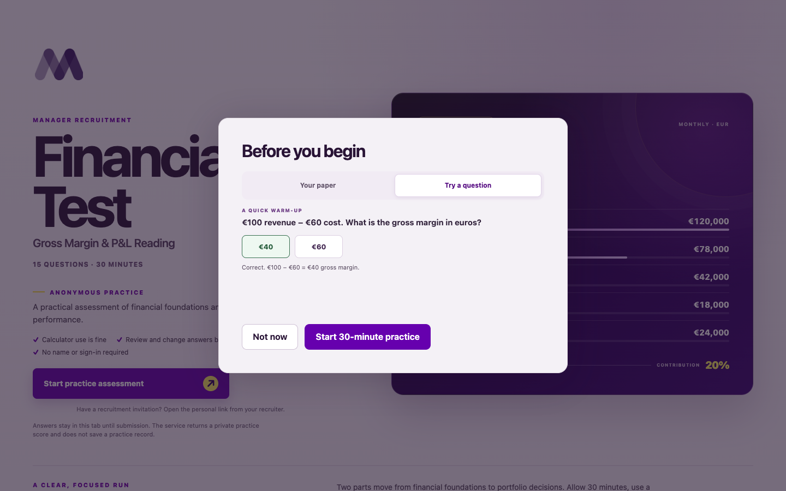
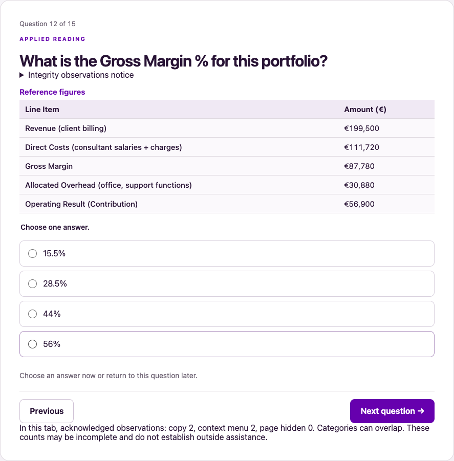
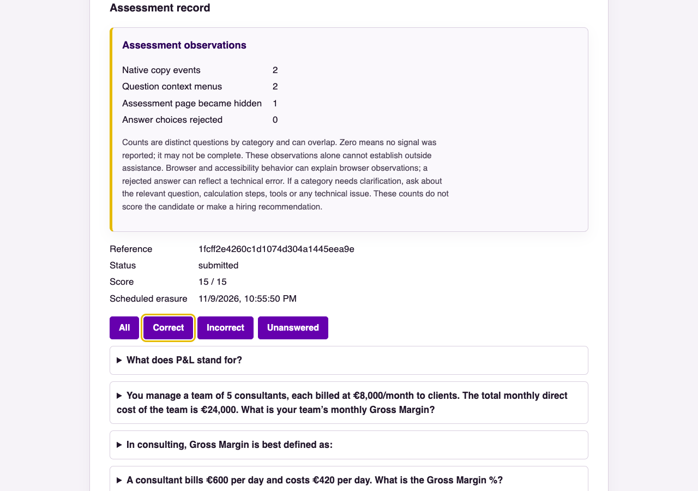
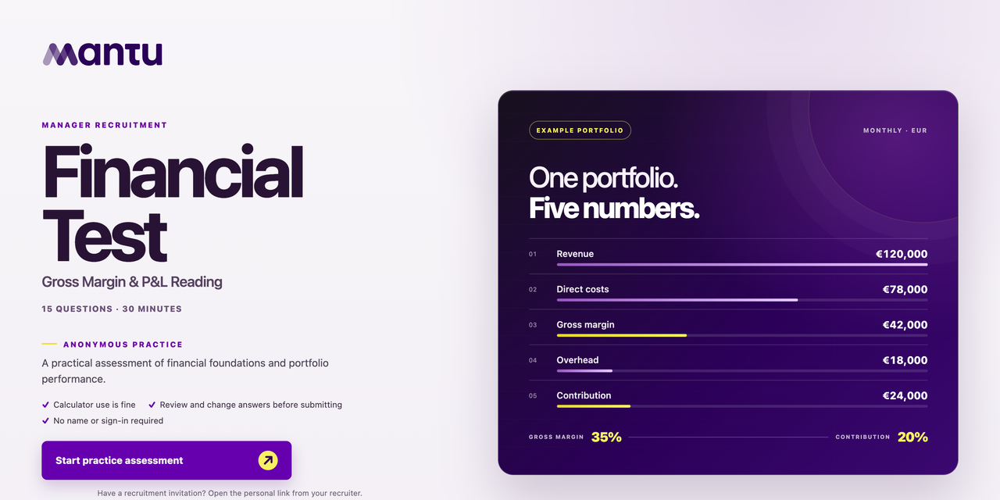

<p align="center">
  
</p>

# Financial Test

<p align="center">
  <a href="https://mantu-financial-assessment.tony-walteur.workers.dev">Open the live practice</a>
</p>

<p align="center">
  
  <br />Homepage, guide, then the paper
</p>

<p align="center">
  
  <br />Question entrance and an answer select
</p>

<p align="center">
  
  <br />Submit, then the private score receipt
</p>

<table>
  <tr>
    <td colspan="2">
      
      <br />Desktop homepage
    </td>
  </tr>
  <tr>
    <td colspan="2" align="center">
      
      <br />Phone homepage
    </td>
  </tr>
  <tr>
    <td width="50%" valign="top">
      
      <br />Practice result
    </td>
    <td width="50%" valign="top">
      
      <br />Gross-margin warm-up
    </td>
  </tr>
  <tr>
    <td width="50%" valign="top">
      
      <br />Applied case, integrity notice
    </td>
    <td width="50%" valign="top">
      
      <br />Same case, second set of figures
    </td>
  </tr>
  <tr>
    <td colspan="2">
      
      <br />Reviewer record
    </td>
  </tr>
  <tr>
    <td colspan="2">
      
      <br />Social card, 1280×640
    </td>
  </tr>
</table>

<details>
<summary>Run it</summary>

A 15-question practice paper on gross margin and portfolio P&L. Recruitment stays closed unless Tony sets `LIVE_ENABLED`. The checked-in value is `false`.

Names only. Values stay out of the repo: `PRACTICE_KEY` (64 hexadecimal characters; local dev reads a throwaway from ignored `.dev.vars`), `ACCESS_ISSUER`, `ACCESS_AUD`, `RATE_KEY`, `OPS_TOKEN` (the process reads it as `ASSESSMENT_OPS_TOKEN`).

Node 22.12 or later.

```sh
npm ci
npm test
npm run test:integration
npm run test:candidate-ui
npm run test:practice-ui
PLAYWRIGHT_CHROMIUM_CHANNEL=chrome npm run test:reviewer
npm run build
npm run dev
```

`npm run dev` serves the app on loopback. [Privacy](docs/PRIVACY.md)

</details>
