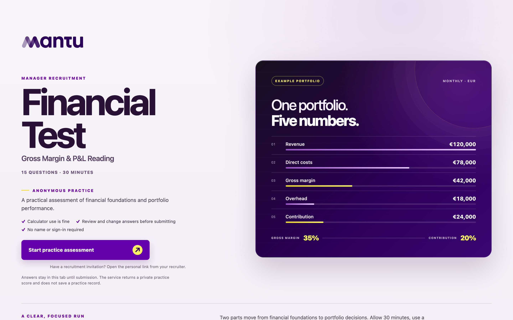

# Mantu Financial Test

<p align="center">
  
</p>

## What this is / how to run

A 15-question practice paper on gross margin and portfolio P&L. [Open the live practice](https://mantu-financial-assessment.tony-walteur.workers.dev).

Recruitment stays closed unless Tony sets `LIVE_ENABLED`. The checked-in value is `false`.

Names only. Values stay out of the repo.

| Name | Role |
| --- | --- |
| `PRACTICE_KEY` | 64 hexadecimal characters. Local dev reads a throwaway value from ignored `.dev.vars`. |
| `ACCESS_ISSUER` | Access team origin. |
| `ACCESS_AUD` | Access audience tag. |
| `RATE_KEY` | Rate-limit secret. |
| `OPS_TOKEN` | Operator secret. The process reads it as `ASSESSMENT_OPS_TOKEN`. |

Node 22.12 or later.

```sh
npm ci
npm test
npm run test:integration
npm run test:candidate-ui
npm run test:practice-ui
PLAYWRIGHT_CHROMIUM_CHANNEL=chrome npm run test:reviewer
npm run build
npm run dev
```

`npm run dev` serves the app on loopback.

## Desktop and mobile

<table>
  <tr>
    <td valign="top" width="72%">
      
    </td>
    <td valign="top" width="28%">
      
    </td>
  </tr>
</table>

Social card: [`docs/screenshots/social-card.png`](docs/screenshots/social-card.png) (1280×640).

[Privacy](docs/PRIVACY.md)
