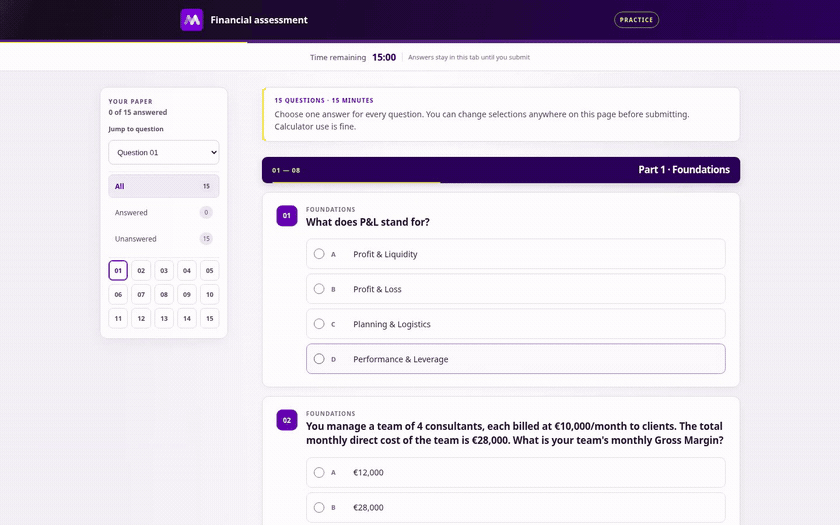
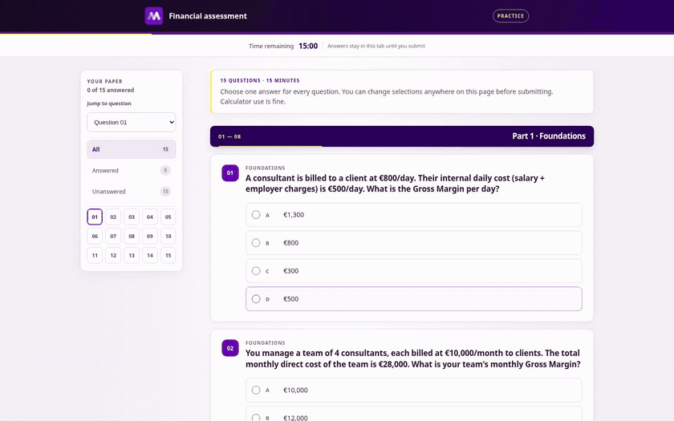

# Mantu financial assessment

A fifteen-minute Gross Margin and P&L paper. The public site is an anonymous practice run. A recruitment invitation is a separate sitting, with its own notice, clock, and confidential receipt.

**[Open the live practice](https://mantu-financial-assessment.tony-walteur.workers.dev/)**

Practice needs no name and no sign-in. The Worker returns a private score and does not save a practice record. Recruitment scoring ships closed: `LIVE_ENABLED` is `false` until a reviewed configuration turns it on.

<table>
  <tr>
    <td width="33%" align="center">
      
    </td>
    <td width="33%" align="center">
      
    </td>
    <td width="33%" align="center">
      
    </td>
  </tr>
  <tr>
    <td align="center"><strong>Studio</strong><br />The ledger settles, then the guide opens.</td>
    <td align="center"><strong>Paper</strong><br />One choice updates the navigator.</td>
    <td align="center"><strong>Score</strong><br />Fifteen minutes, then private feedback.</td>
  </tr>
</table>

The clips are the local practice path: home, a selected answer, and a finished paper. They contain no invitation, no reviewer session, and no stored identity. Motion in the product plays once and stays still when the operating system asks for reduced motion.

## Practice and recruitment

| | Practice | Recruitment |
| --- | --- | --- |
| Who | Anyone, from the homepage | A candidate with one invitation |
| Clock | 15 minutes, started on confirmation | 15 minutes, started after the notice |
| Paper | Eight foundation questions, seven applied | The same coverage, with figures generated for that attempt |
| What the sitter sees | A score out of 15 and a band | A receipt. The grade stays with the reviewer |
| What is stored | Nothing about the attempt. Answers stay in the tab until submit | A private EU record, erased on the application schedule |
| Hiring use | None. The score is not sent to recruiters | A person reviews the result. The app does not decide |

Practice shuffles questions inside each part and shuffles the choices. A refresh clears an unfinished practice paper. The result stays on the page for up to 30 minutes, then clears. Retake starts a new paper.

An invitation is normally open to start for 30 minutes. The candidate’s answer window is the promised duration. One browser tab stays bound to that invitation. Submitters get a receipt; reviewers open `/review/` and look up the attempt. Countries without a complete notice cannot start a scored invitation.

## Architecture

```text
public/                 studio, practice paper, candidate flow, reviewer
src/worker.js           routes, sessions, grading, retention
src/practice.js         practice bank and the encrypted challenge
src/bank.js             recruitment scenarios

Practice     POST /api/practice/start | /api/practice/submit
             challenge sealed with PRACTICE_KEY, no R2 record

Recruitment  invitation, answers, submit
             EU Durable Object serializes the attempt
             private EU R2 holds the record
             SQLite holds cleanup alarms only

Staff        /review/ and /api/ops/*  behind Cloudflare Access
```

The browser never receives the answer key. Practice responses are an aggregate score, a total, an answered count, and a timestamp. Recruitment responses to the candidate omit the grade.

## Run and test

Node 22.12 or later.

```sh
npm ci
npm test
npm run test:integration
npm run test:candidate-ui
npm run test:practice-ui
PLAYWRIGHT_CHROMIUM_CHANNEL=chrome npm run test:reviewer
npm run dev
```

Local practice needs a throwaway `PRACTICE_KEY`: 64 hexadecimal characters, one per byte of a random 32-byte value. Put it in an ignored `.dev.vars` file as `PRACTICE_KEY=...`. Use a development-only value. Do not copy a production secret into the repo, the shell history you share, or this file.

`npm run dev` serves the app on loopback through Wrangler. The local entrypoint adapts the EU binding for the emulator. Only a real deploy asks for EU placement.

## Deploy

```sh
npm run build
npm run deploy
```

Deploy from the intended Cloudflare account. `npm run build` is a dry run. The checked-in configuration leaves recruitment scoring closed. Leave `LIVE_ENABLED` as `false` until the country notices, Access policy, and processor authorization in [the privacy handoff](docs/PRIVACY.md) are actually in place. A later deploy republishes the vars in the local configuration, so a casual `true` will open scoring.

Production `PRACTICE_KEY` is a Worker secret, not a var in this repo. Rotate it only on purpose: open practice challenges stop validating when it changes.

Operator commands, when a separate ops secret is configured, are `npm run ops -- invite`, `get`, and `delete`. Do not put that secret in a URL or in the reviewer page.

## Further reading

- [Privacy handoff](docs/PRIVACY.md) for retention, metadata, and what the application does not promise to erase
- [Verification record](docs/VERIFICATION.md) for hosted practice and synthetic recruitment evidence
- [Implementation plan](docs/PLAN.md) and [design notes](DESIGN.md)
