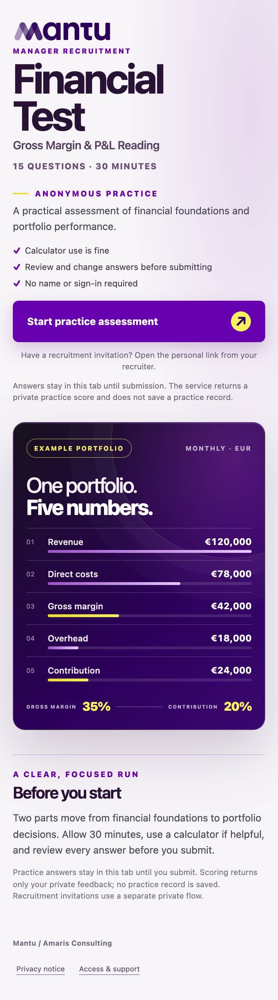
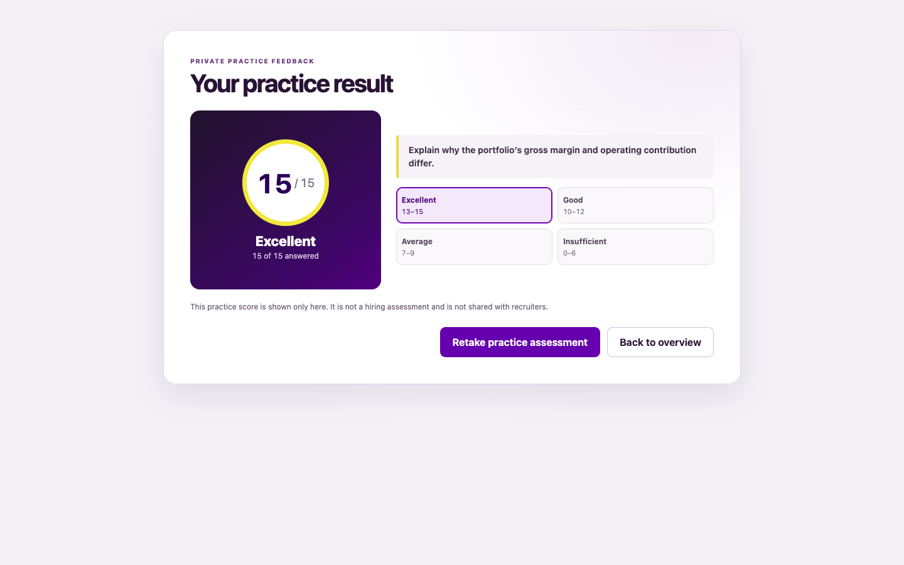
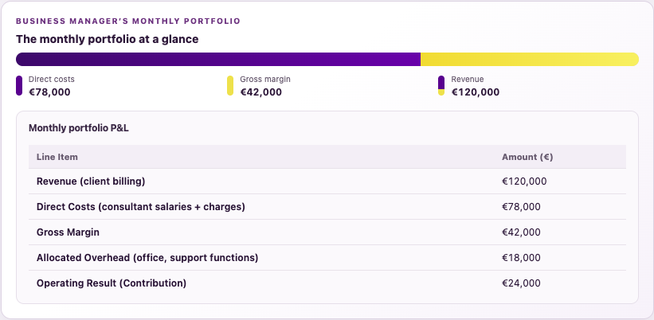
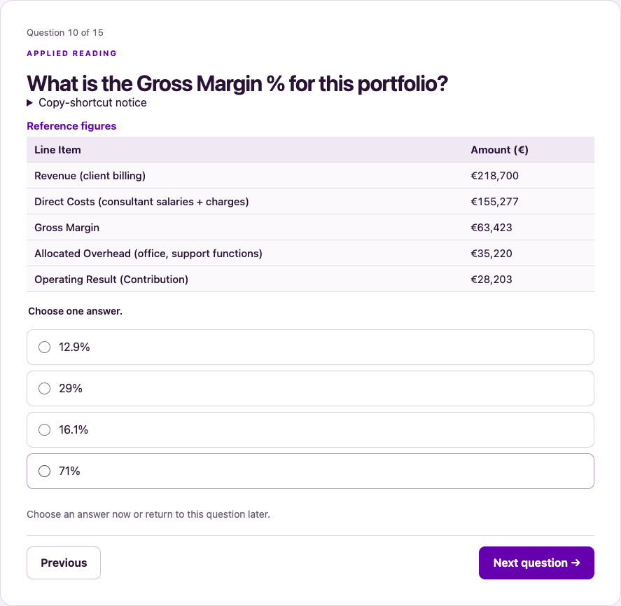

<p align="center">
  
</p>

# Financial Test

A 15-question practice paper on gross margin and portfolio P&L.

[Open the live practice](https://mantu-financial-assessment.tony-walteur.workers.dev)

Recruitment stays closed unless Tony sets `LIVE_ENABLED`.

<p align="center">
  
</p>

## Desktop and mobile

<table>
  <tr>
    <td valign="top" width="72%">
      
    </td>
    <td valign="top" width="28%">
      
    </td>
  </tr>
</table>

## Result and warm-up

<table>
  <tr>
    <td valign="top" width="50%">
      
    </td>
    <td valign="top" width="50%">
      
    </td>
  </tr>
</table>

## On the paper

<table>
  <tr>
    <td valign="top">
      
    </td>
    <td valign="top">
      
    </td>
    <td valign="top">
      
    </td>
  </tr>
  <tr>
    <td valign="top">
      
    </td>
    <td valign="top">
      
    </td>
    <td valign="top">
      
    </td>
  </tr>
</table>

## Social card

<a href="https://mantu-financial-assessment.tony-walteur.workers.dev">
  
</a>

`docs/screenshots/social-card.png` is a 1280×640 crop of the desktop homepage.

## Practice

Choose **Start practice assessment** on the [live practice](https://mantu-financial-assessment.tony-walteur.workers.dev). The guide includes an optional gross-margin warm-up, then **Start 30-minute practice**. The paper has eight foundation questions and seven applied questions. The Worker shuffles question order within each section and shuffles answer positions. Answers stay in the page until submit. The challenge is encrypted with `PRACTICE_KEY` and expires 30 minutes after issue. The response contains an aggregate score, total, answered count, and timestamp. Bands are Excellent, Good, Average, and Insufficient. Practice scores are private to that browser session.

Use Node 22.12 or later.

```sh
npm ci
npm test
npm run test:integration
npm run test:candidate-ui
npm run test:practice-ui
PLAYWRIGHT_CHROMIUM_CHANNEL=chrome npm run test:reviewer
npm run build
npm run dev
```

`npm run dev` serves the app on loopback. `npm run deploy` is for the authenticated Cloudflare account only. The checked-in configuration ships with recruitment scoring closed.

## Secret names

These are names only. Values stay in the approved secret store and out of source, configuration vars, and chat.

| Name | Role |
| --- | --- |
| `PRACTICE_KEY` | 64 hexadecimal characters (32 bytes). Worker secret for practice challenges. Local development reads a throwaway value from an ignored `.dev.vars` file. |
| `ACCESS_ISSUER` | HTTPS team origin for the reviewer Access application. |
| `ACCESS_AUD` | Access application audience tag. |
| `RATE_KEY` | High-entropy Worker secret for rate limiting. |
| `OPS_TOKEN` | High-entropy Worker secret for the command-line operator flow, when that flow is required. The process reads it as `ASSESSMENT_OPS_TOKEN`. |

Recruitment stays closed unless Tony sets `LIVE_ENABLED`.

[Privacy handoff](docs/PRIVACY.md) · [Verification](docs/VERIFICATION.md) · [Recovery](RECOVERY.md)
